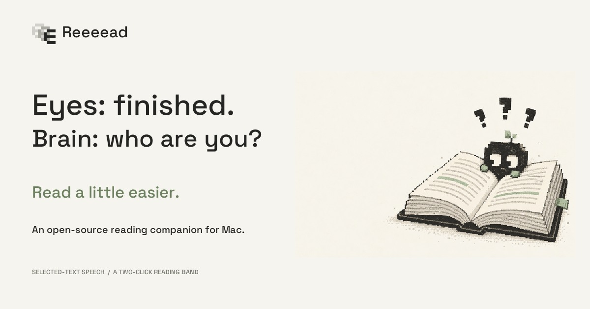
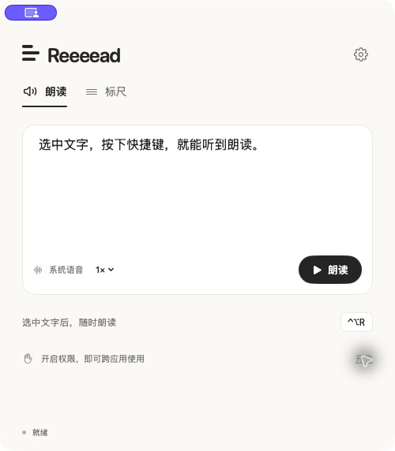

<div align="center">

# Reeeead

### Read a little easier.

Selected-text speech. A two-click reading band. A small, open-source Mac companion.

[Website](https://reeeead.frosty-olive-3604.chatgpt.site) · [简体中文](README.zh-CN.md) · [Get started](#get-started) · [Contribute](CONTRIBUTING.md)

[](https://github.com/YFJack/reeeead/actions/workflows/build.yml)

[](LICENSE)

[](https://reeeead.frosty-olive-3604.chatgpt.site/#film)

*For the sentence you've read three times. Give your ears a turn. Give your eyes some room.*

</div>

## Two things, done quietly

**Select it. Hear it.** Select text in a supported Mac app and press `⌃⌥R`. Use macOS voices, MiniMax, or your own OpenAI-compatible speech endpoint. Set the speed, pause, resume, or stop. Bind a keyboard shortcut or a mouse side button.

**One line. A little breathing room.** Press `⌃⌥L`. Click to set the top edge, then click to set the bottom. Everything outside your reading band dims. The band stays in place while you scroll and click through to the original app. Press the shortcut again or `Esc` to close.

<table><tr><td width="55%">

- Native Swift, AppKit and SwiftUI
- No third-party runtime packages
- A compact 500 × 570 window
- System voices or your own API
- No account, ads, telemetry, or reading history
- MIT-licensed app code

</td><td>


</td></tr></table>

The current app interface is **Chinese**. The website and documentation are bilingual. English UI contributions are welcome.

## Get started

**Source preview:** macOS 14+, Xcode 15 / Swift 5.9 or newer. There is no notarized one-click installer yet.

```sh
git clone https://github.com/YFJack/reeeead.git
cd reeeead
./scripts/build.sh
open dist/Reeeead.app
```

1. Try speech inside Reeeead first; that does not need Accessibility permission.
2. Move the app into Applications for a stable authorization path.
3. Open Settings → Shortcuts and grant **Reeeead** macOS Accessibility access. Return and recheck permission.
4. Select text in a text editor or browser and press `⌃⌥R`.
5. Start the reading band with `⌃⌥L` and click its two boundaries.

Closing the window keeps the menu bar app running. Choose Quit Reeeead in the menu bar to exit completely. Rebuilding or changing the app's signature may require renewed Accessibility or Keychain authorization.

### Bring your own voice

| Voice option | What you need |
| --- | --- |
| macOS system speech | Installed system voices; no paid API key |
| MiniMax | Your own MiniMax API key, model and voice |
| OpenAI-compatible TTS | A full HTTPS endpoint, supported model/voice, and your own key if required |

The compatible endpoint must accept `POST` with `model`, `voice`, `input`, `speed`, and `response_format: "mp3"`, and return audio bytes. Providers with different protocols need an adapter. Localhost endpoints may use HTTP. External providers may charge for usage; the app includes no API credits.

MiniMax defaults: `https://api.minimax.cn/v1/t2a_v2`, model `speech-2.8-hd`, voice `male-qn-qingse`. Settings are editable. The promotional film's calm narrator is a separate production setting, not a new in-app preset.

### Mouse buttons and displays

Record a side button in Settings → Shortcuts, or choose Mouse 4 / Mouse 5. Modifier keys are supported. If a driver turns a side button into a keyboard macro, record that keyboard shortcut or restore ordinary button behavior in the driver.

The ruler starts on the **display containing the pointer**. It does not follow the pointer to a second display after activation. Display changes and sleep close it. External-display, physical-keyboard and mouse-hardware acceptance testing is still in progress; see the [verification record](docs/VERIFICATION.md).

## Your reading is your business

- System speech uses the macOS speech engine; Reeeead does not send this text to a cloud API.
- Choosing a cloud voice sends only the text you ask to read to your configured provider. That provider's data policy applies.
- API keys live in the macOS Keychain, isolated by the full endpoint URL. Reading history is not stored.
- The ruler draws a transparent window. It neither records nor captures your screen and needs no Screen Recording permission.
- The optional copy fallback backs up and restores clipboard representations, including screenshots and file references. Large backups use private temporary storage and are deleted afterward. Clipboard managers and concurrent copies can affect restoration; disable the fallback for sensitive clipboard workflows.
- A local permissions diagnostic contains app path/version and permission states, not selected text, input history or secrets.

Full limits and implementation details: [Chinese guide](README.zh-CN.md), [architecture](docs/ARCHITECTURE.md), [verification](docs/VERIFICATION.md).

## Honest limits

Reeeead is a reading aid, with no clinical benefit claims. Selection support varies by application. It does not include OCR, scanned-PDF or image reading, word-by-word highlighting, Windows support, or streaming speech playback. Cloud speech waits for the current audio response before playing. Each request is limited to 4,000 characters and 24 MB of audio.

## Help it get better

Useful contributions include selection compatibility fixes, reproducible multi-monitor reports, mouse button testing, English UI localization, and voice-provider adapters. See [CONTRIBUTING.md](CONTRIBUTING.md) and [open an issue](https://github.com/YFJack/reeeead/issues/new/choose). Never include API keys or private document text.

```sh
swift test -j 1
./scripts/build.sh debug
```

For opt-in HTTP integration tests, run `python3 scripts/mock-tts.py` separately, then `LUMA_LOCAL_API_TESTS=1 swift test -j 1`. Mock tests verify protocol behavior, not a real provider's voice quality.

If Reeeead makes your reading a little easier, a GitHub star helps other readers find it. Sharing a useful bug report helps even more.

## Built in the open

The [website source](website), [film renderer and script](marketing/video), and [asset provenance](docs/ASSETS.md) live alongside the app. The 34-second launch film uses original animation, a real app screenshot, generated editorial illustration, and MiniMax narration. Feature animations are labeled as illustrations.

App code and geometric pixel mark: [MIT](LICENSE). Bundled Space Grotesk and retained OpenDyslexic fonts: [SIL OFL notices](Sources/Reeeead/Resources/Fonts). Generated artwork provenance and usage notes: [ASSETS](docs/ASSETS.md).
