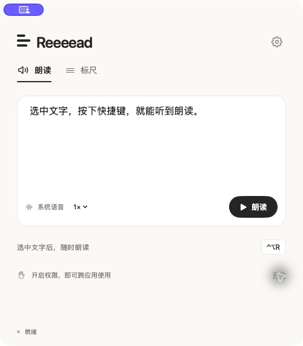

# Reeeead

[English](README.md) · [产品主页](https://reeeead.frosty-olive-3604.chatgpt.site/zh/) · [34 秒短片](https://reeeead.frosty-olive-3604.chatgpt.site/zh/#film)

**一个安静、轻量的 macOS 阅读工具。**

一个轻量、原生、开源的 macOS 阅读辅助工具。选中文字，让它读给你听；用两次点击框出阅读带，让视线更容易停留。



## 能做什么

- **选区朗读**：在其他应用选中文字，按 `⌃⌥R` 开始朗读，再按一次停止。
- **自定义全局快捷键**：各功能分别自选键盘或鼠标快捷键，可搭配 ⌘ / ⌥ / ⌃ / ⇧。检测键盘注册冲突与各功能的重复绑定。
- **系统语音**：按文本选择中文或英文，也可以指定本机已安装的声音。支持语速设置、暂停、继续、停止。
- **外部语音 API**：支持 MiniMax 原生协议与 OpenAI 兼容的语音合成协议，可配置完整地址、模型、音色与语速。API Key 保存在 macOS 钥匙串，按完整接口地址隔离。
- **屏幕阅读标尺**：按 `⌃⌥L`，横线跟随鼠标；第一次点击固定上边界，向下移动，第二次点击固定下边界。区域之外变暗，中间保持原亮度。
- **固定后照常操作**：阅读带停留在屏幕原位，鼠标点击和滚动穿透到原应用。再次按快捷键或 `Esc` 退出。
- **轻量界面**：500 × 570 的小窗口、黑灰文字和暖白背景。主界面保留朗读、标尺和窗口聚焦入口，其他选项收进设置。

- **中英双语**：默认跟随系统语言，在设置 →「快捷键」→「界面语言」中随时切换 English / 简体中文，不改变已有语音、API 或快捷键配置。

## 快速开始

需要 **macOS 14 或更新版本**。源码构建需要 **Xcode 15 / Swift 5.9 或更新版本**。无第三方包依赖。

```sh
git clone https://github.com/YFJack/reeeead.git
cd reeeead
./scripts/build.sh
open dist/Reeeead.app
```

将 `dist/Reeeead.app` 拖到「应用程序」后再开启辅助功能权限，可以保持授权路径稳定。关闭窗口后应用继续驻留菜单栏；从菜单栏选择「退出 Reeeead」完全退出。

### 第一次使用

1. 在主界面试听一段文字，不需要辅助功能权限。
2. 点击右上角设置 →「快捷键」→「开启」。在 macOS 的辅助功能权限列表中开启 **Reeeead**。
3. 回到 Reeeead 点击「重新检查」。切到文本编辑器、浏览器或文档应用，选中文字后按 `⌃⌥R`。
4. 按 `⌃⌥L` 开始设置阅读带。定位的两次点击不会传给底层应用；第二次松开鼠标后恢复普通点击与滚动。

标尺只覆盖**启动时鼠标所在的显示器**。下边界不能越过上边界，最小高度为 8 点。屏幕配置改变或电脑休眠时自动收起。

### 窗口聚焦

按 **左 Shift + Esc** 保留当前最前面的窗口正常亮度，压暗所有显示器上窗口以外的区域。窗口移动、缩放或切换时自动跟随，鼠标点击和滚动照常使用。再按一次快捷键或单独按 Esc 收起。在设置 →「快捷键」可以修改绑定，窗口聚焦旁的调节按钮提供预览和 0–100% 透明度滑块，拖动立即生效并独立保存，不影响标尺设置；开启时也可从菜单栏调节。窗口圆角默认 12 pt，可在调节面板中改为 0–24 pt；覆盖整块显示器的窗口使用直角。跟随使用窗口变化通知，拖动期间最多每秒更新 60 次，静止时低频兜底检查。窗口聚焦与阅读标尺互斥，需要辅助功能权限；无法读取当前窗口时暂时隐藏遮罩，避免整屏变暗。屏幕配置改变或休眠时自动收起。

### 锁定、添加窗口和专注循环

高亮窗口外有三个小圆按钮；窗口占满屏幕时，按钮放在屏幕角落以保持可点击。

- **锁定**：点击其他窗口也保留当前高亮；解锁后恢复跟随。
- **＋**：保留已有窗口，再点击另一个窗口加入。Esc 取消添加，不重复添加同一个窗口。最小化、关闭或移到其他桌面的窗口不会留下旧的亮区；盖在锁定窗口上的其他窗口仍然变暗。
- **25 Focus**：所有高亮窗口共用一轮计时。绿色倒数环专注 25 分钟，自动切换到红色倒数环休息 5 分钟；休息时暗区缓慢呼吸，结束后自动开始下一轮。再点计时按钮停止循环。关闭窗口聚焦或休眠会结束本轮；开启系统“减少动态效果”时，休息改为静态减轻遮罩。

窗口四角带半透明细线与柔光，内容保持清晰。

### 自定义快捷键

点击首页的快捷键按钮，或设置 →「快捷键」，按下想用的按键，松开即可保存；Esc 取消。新录入的 Shift 组合会区分左右键，Shift＋鼠标按键同样支持；已有的通用 Shift 设置保持不变，重新录入后才区分左右。支持字母、功能键、方向键、导航键、数字小键盘、中键及其他鼠标按钮。左／右键可以搭配修饰键使用，普通左／右键保留给日常操作。鼠标全局快捷键需要 Reeeead 的辅助功能权限，每台 Mac 单独授权。

匹配的鼠标快捷键在松开时触发一次，按下和松开都会拦截，避免同时触发浏览器导航。未绑定的鼠标按键保持原样。鼠标驱动若已将侧键改成键盘宏，可改为录入对应组合键，或在鼠标驱动中恢复普通鼠标 4 / 5。硬件兼容性及实测边界见 [验证记录](docs/VERIFICATION.md)。

多台 Mac 的安装与更新见 [部署说明](docs/DEPLOYMENT.md)。

### 外部语音服务

**MiniMax**：设置 →「语音」→「MiniMax」，保存 Key 后即可试听。默认使用 `https://api.minimax.cn/v1/t2a_v2`、`speech-2.8-hd` 和 `male-qn-qingse`；模型与音色均可编辑。按[官方同步语音接口](https://platform.minimax.cn/docs/api-reference/speech-t2a-http)发送请求并解析 JSON 中的音频。切换服务时保留各服务的配置。

**OpenAI 兼容服务**：设置 →「语音」→「外部 API」。填写**完整的语音接口地址**，并保存此地址对应的 Key。

默认地址是 `https://api.openai.com/v1/audio/speech`，默认模型 `tts-1`、音色 `alloy`。这些只是可编辑的兼容配置，不包含服务账户或免费额度。其他厂商必须接受以下请求格式：

```json
{
  "model": "your-model",
  "voice": "your-voice",
  "input": "你选中的文字",
  "speed": 1.0,
  "response_format": "mp3"
}
```

请求为 `POST`，密钥通过 `Authorization: Bearer …` 发送。此兼容模式下，服务须直接返回音频二进制，不能只返回音频 URL 或 JSON。独立协议的厂商需要额外适配，**不是所有 TTS API 都自动兼容**。

- 远程地址必须使用 HTTPS；本机 `localhost` / `127.0.0.1` 可以使用 HTTP。
- 空密钥允许调用本机免鉴权服务。
- 每次最多 4,000 字，单次音频最多 24 MB，不保存朗读历史。
- 请求重定向会被拒绝，避免凭据转发至其他地址。
- 停止朗读会取消未完成请求；已经到达服务端的请求仍可能产生服务费用。
- 当前版本等待本段音频下载完成再播放，尚无流式播放。
- 语速对下一次朗读生效；系统语音和不同服务的速度刻度并非完全相同。

## 隐私与权限

- 无遥测、无广告、无 Reeeead 账号、无项目自建后端。
- 系统语音由 macOS 本机语音引擎处理。Reeeead 不将系统朗读文本发送到外部 API。
- 选择外部 API 后，**只有主动朗读的文字**会发送至所配置的服务；该服务自己的数据政策仍适用。
- API Key 仅保存在钥匙串；语音设置和快捷键保存在本机 UserDefaults。试读区文字只保留在当前进程内。
- 应用在本机保存 `~/Library/Application Support/Reeeead/permissions.json`，仅包含版本、安装路径、进程和权限状态，便于排查授权问题；不含选中文字、输入记录或密钥。
- 标尺通过透明窗口绘制，不截图、不录屏，不需要屏幕录制权限。
- 辅助功能权限用于读取选区、模拟复制，以及标尺工作期间监听并拦截 Esc。Esc 监听在退出标尺后释放。
- 复制兼容模式先尝试辅助功能接口，只有读取失败才模拟 `⌘C`。复制成功后尽量恢复剪贴板，包括截图、文件引用及原有格式。小内容在内存中备份，较大内容临时保存在本机私有目录，操作结束后删除；所有格式合计超过 256 MB 或无法完整备份时，保留原内容并提示。剪贴板管理器、延迟复制与并发写入可能影响恢复，敏感工作流可关闭兼容模式。

更多边界见 [验证记录](docs/VERIFICATION.md) 与 [架构说明](docs/ARCHITECTURE.md)。

## 开发与验证

```sh
swift test -j 1                 # 核心测试；本机 API 集成测试默认跳过
./scripts/build.sh debug        # 调试应用包
./scripts/build.sh release      # 优化构建，默认单任务编译
```

本机 API 集成测试（两个终端）：

```sh
python3 scripts/mock-tts.py
LUMA_LOCAL_API_TESTS=1 swift test -j 1
```

模拟服务只绑定 `127.0.0.1:8642`，返回低音量测试音，验证 HTTP、音频解码、暂停恢复、取消、401 与重定向处理；**不能证明真实厂商的语音质量或端到端兼容性**。

### 签名与发行

构建脚本默认使用本机 ad-hoc 签名。自行编译运行不等于完成 Apple Developer ID 签名或公证。重建后，辅助功能权限或钥匙串访问可能需要重新确认。

正式对外分发时可设置 `LUMA_SIGN_IDENTITY` 使用自己的签名身份，并按 Apple 的流程启用 hardened runtime、签名、公证和 staple。当前仓库不包含签名证书、开发者账号或公证凭据。

## 当前范围

macOS 优先；尚不支持 Windows、OCR、图片/扫描件朗读、自动逐字高亮或非兼容 TTS 协议。不同应用对辅助功能选区的支持不同，不能保证“任何软件都能读”。使用 [问题模板](.github/ISSUE_TEMPLATE/bug_report.md) 反馈应用名、macOS 版本、复现步骤即可，请勿附上 API Key 或敏感文档。

## Contributing / English

Reeeead is a native macOS reading companion built with Swift, AppKit and SwiftUI. It reads selected text using system speech MiniMax or a configurable OpenAI-compatible TTS endpoint, and provides a two-click, click-through screen reading band. Requires macOS 14+. No third-party runtime dependencies.

Build with `./scripts/build.sh`; run `swift test -j 1`. Contributions that improve selection compatibility, accessibility and provider adapters are welcome. See [CONTRIBUTING.md](CONTRIBUTING.md).

## License

[MIT](LICENSE) for app code and the geometric pixel echo mark. Space Grotesk is separately licensed under [SIL OFL 1.1](Sources/Reeeead/Resources/Fonts/SpaceGrotesk-OFL.txt). The retained OpenDyslexic font is separately licensed under [SIL OFL 1.1](Sources/Reeeead/Resources/Fonts/OFL.txt). UI symbols use the native system symbol library. Generated logo concept and asset provenance: [docs/ASSETS.md](docs/ASSETS.md).
